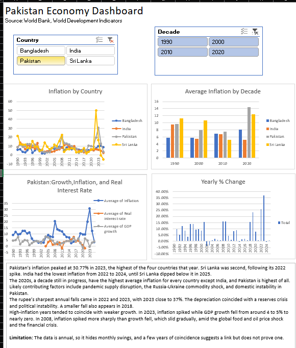

# Pakistan Economy Dashboard

An interactive Excel dashboard comparing Pakistan's macroeconomic indicators with India, Bangladesh and Sri Lanka, built with Power Query, pivot tables and formulas.

## Question

How have inflation, economic growth, interest rates and the exchange rate moved in Pakistan since 1990, and how does Pakistan compare with its regional peers?

## Data

- Source: World Bank, World Development Indicators (databank.worldbank.org)
- Countries: Pakistan, India, Bangladesh, Sri Lanka
- Years: 1990 to the latest year available
- Indicators: GDP growth (annual %), inflation (consumer prices, annual %), official exchange rate (local currency per US$, period average), real interest rate (%)
- The raw download is in the data folder (wdi_raw.csv)

## Tools

Microsoft Excel: Power Query, pivot tables, PivotCharts, slicers, and formulas (MAXIFS, AVERAGEIFS, COUNTIFS).

## Method

1. Downloaded the data as a CSV from the World Bank DataBank.
2. Cleaned it in Power Query: removed footer rows, converted missing-value markers to nulls, unpivoted the year columns, extracted the year as a number, set data types, pivoted indicators into columns, renamed columns and added a Decade column.
3. Loaded the result into an Excel table and analysed it with four pivot tables: inflation by year, average inflation by decade, Pakistan's growth, inflation and real interest rate together, and the yearly percentage change in the exchange rate.
4. Calculated headline figures with conditional formulas.
5. Built a dashboard with four charts, headline cards and slicers (Country and Decade).

## Key findings

1. Pakistan's inflation peaked at 30.77% in 2023, the highest of the four countries that year. Sri Lanka was second, following its 2022 spike. India had the lowest inflation from 2022 to 2024, until Sri Lanka dipped below it in 2025.
2. The 2020s, a decade still in progress, have the highest average inflation for every country except India, with Pakistan highest of all. Likely contributing factors include pandemic supply disruption, the Russia-Ukraine commodity shock, and domestic instability in Pakistan.
3. The rupee's sharpest annual falls were in 2022 and 2023, with 2023 close to 37%.
4. High-inflation years tended to coincide with weaker growth. In 2023, inflation spiked while GDP growth fell from around 4 to 5% to nearly zero. In 2008, inflation spiked more sharply than growth fell.

## Limitations

- The data is annual, so it hides monthly swings.
- A few years of coincidence suggests a link between inflation and growth but does not prove causation.
- Causes mentioned above are likely contributing factors, not conclusions drawn from this data.

## How to use

Download the .xlsx file from the excel folder and open it in desktop Excel. Use the Country slicer to focus on one country (it affects the two bottom charts) and the Decade slicer to filter all four charts.

## Author

Hasnain